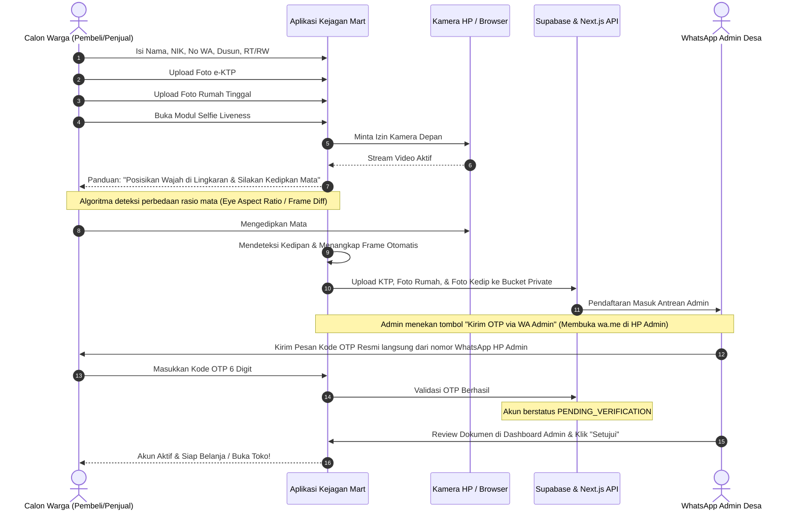

# Dokumentasi Sistem & Panduan Implementasi — Kejagan Mart
**Aplikasi**: Kejagan Mart (Marketplace Khusus Warga Se-Desa Kejagan)  
**Tumpukan Teknologi**: Next.js 16 + Supabase + Vercel + Capacitor Android  
**Tanggal**: 2026-11-24  

---

## 1. Ikhtisar Arsitektur & Alur Kerja Sistem

Kejagan Mart dibangun di atas arsitektur web modern yang ringan, hemat biaya, dan mudah dirawat oleh perangkat desa. Menggunakan kombinasi **GitHub** (penyimpanan kode & versi), **Supabase** (basis data PostgreSQL & penyimpanan aman dokumen KYC), dan **Vercel** (hosting serverless berkinerja tinggi). Aplikasi ini dirancang agar dapat diakses melalui browser ponsel warga maupun diinstal sebagai aplikasi mandiri di smartphone Android (file `.apk`).

```
┌─────────────────┐       ┌─────────────────┐       ┌────────────────────────┐
│  Kode di GitHub │ ────► │ Deploy Otomatis │ ────► │ Supabase (DB & Storage)│
│  (Repository)   │       │   di Vercel     │       │ (PostgreSQL, Auth, RLS)│
└─────────────────┘       └─────────────────┘       └────────────────────────┘
                                   │
                                   ▼
                   ┌────────────────────────────────┐
                   │    Aplikasi Web Responsif      │
                   │  & Kemasan APK Android (Cap)   │
                   └────────────────────────────────┘
```

---

## 2. Bedah Alur Registrasi KYC Desa & Deteksi Kedip Mata (Liveness Check)

Keamanan desa bergantung pada keaslian identitas pengguna. Untuk mencegah akun palsu atau orang luar yang tidak berdomisili di Desa Kejagan, diterapkan 4 lapis verifikasi:



### 2.1 Alur Pengiriman OTP Langsung via WhatsApp HP Admin (Tanpa Gateway)
Sistem sengaja dirancang **tanpa gateway berbayar (zero gateway cost)**:
1. Saat warga menekan tombol daftar, sistem membuat kode OTP acak 6 digit dan menyimpannya di tabel database dengan masa berlaku 10 menit.
2. Di dashboard verifikator desa, pendaftar baru muncul dengan tombol: **"📱 Kirim OTP via WhatsApp Admin"**.
3. Ketika Admin mengklik tombol tersebut, browser/aplikasi admin mengeksekusi *deep-link* protokol WhatsApp:
   `https://wa.me/628xxxxxxxxxx?text=*KEJAGAN%20MART%20-%20KODE%20OTP*%0AHalo%20Bpk/Ibu%20Siti,%20kode%20OTP%20pendaftaran%20Anda:%20*482910*`
4. Aplikasi WhatsApp di smartphone Admin terbuka otomatis dengan teks pesan yang sudah tersusun rapi. Admin cukup menekan tombol **Kirim**.
5. Warga menerima pesan WhatsApp dari nomor asli perangkat desa yang mereka kenali dan memasukkan 6 digit OTP tersebut ke aplikasi.

---

### 2.2 Master Data Wilayah Desa & Filter Dusun
1. **Dikelola Penuh oleh Superadmin (Kepala Desa)**:
   - Superadmin dapat mengatur identitas wilayah secara fleksibel: **Nama Desa**, **Kecamatan**, **Kabupaten**, dan **Provinsi**.
   - Superadmin dapat menambah, mengubah, atau menghapus **Daftar Nama Dusun** (misal: Dusun Krajan, Dusun Kulon, Dusun Lor, Dusun Selatan).
2. **Filter Dusun Otomatis untuk Pembeli**:
   - Di beranda katalog pembeli, daftar dusun muncul sebagai filter cepat.
   - Pembeli dapat memfilter barang yang dijual oleh toko di dusun mereka sendiri, memudahkan pengantaran kilat COD jalan kaki atau ambil mandiri tanpa ongkos kirim.
Deteksi kedip mata berjalan secara ringan langsung di sisi perangkat pengguna (client-side) tanpa memerlukan server AI mahal:
- Menggunakan pustaka *Face Landmarker* ringan (MediaPipe Face Mesh atau deteksi kecerahan pupil / kontur mata pada elemen `<canvas>`).
- Sistem memantau perubahan status mata dari *Terbuka* -> *Tertutup (Kedip)* -> *Terbuka Kembali* dalam rentang 1.5 detik.
- Begitu kedipan valid terdeteksi, kamera otomatis mengambil foto resolusi tinggi dan menandai verifikasi liveness berhasil.

---

## 3. Desain Peran Admin & Superadmin (Penjelasan Lengkap)

Menjawab kebutuhan pengelolaan desa yang sebelumnya belum terdefinisi:

| Aspek | Admin (Verifikator Desa / Karang Taruna) | Superadmin (Kepala Desa / BPD / Koordinator BUMDes) |
|---|---|---|
| **Peran Utama** | Eksekusi harian & verifikasi warga di lapangan | Pengambil kebijakan, pemilik sistem, dan auditor tertinggi |
| **Verifikasi KYC** | Memeriksa kecocokan NIK, foto rumah di RT/RW bersangkutan, dan foto kedip. Berwenang klik *Terima* / *Tolak*. | Dapat melihat riwayat verifikasi dan membatalkan status jika ditemukan kekeliruan. |
| **Manajemen WhatsApp** | Memantau pengiriman OTP dan dapat mengirim ulang OTP jika warga mengalami kendala jaringan. | Mengonfigurasi nomor WhatsApp gateway resmi yang digunakan oleh sistem desa. |
| **Moderasi Produk** | Menyembunyikan barang dagangan yang dilarang (minuman keras, obat tanpa izin, barang ilegal). | Menentukan kategori barang yang diizinkan dan batas ketentuan jual-beli desa. |
| **Manajemen Pengguna** | Mereset nomor telepon warga atau menonaktifkan akun yang melanggar aturan. | Menambah atau menghapus akun staf Admin (mengatur siapa yang bertugas jadi admin). |
| **Laporan & Data** | Memantau transaksi aktif hari ini. | Mengunduh rekap bulanan nilai ekonomi transaksi desa untuk laporan APBDes/Musdes. |

### 3.1 Skema Masuk Aplikasi: Warga (No WA + Password) vs Petugas Desa (Username + Password)

Sesuai aturan keamanan dan kepraktisan warga desa:
1. **Warga (Pembeli & Penjual)**:
   - Menggunakan **Nomor WhatsApp + Password**.
   - *Alasan*: Warga desa sering kali tidak mengingat username atau alamat email yang rumit. Nomor WhatsApp adalah identitas komunikasi utama di desa yang selalu diingat. Password menjaga agar akun tidak disalahgunakan orang lain yang meminjam HP.
2. **Petugas (Admin Verifikator & Superadmin Kepala Desa)**:
   - Menggunakan **Username + Password**.
   - *Alasan*: Akun admin merupakan akun jabatan institusional desa (misal: `admin_verifikator_1`, `kades_kejagan`, `bumdes_admin`). Akun ini tidak terikat pada satu nomor HP pribadi petugas dan dapat dipindahtugaskan secara resmi saat ada pergantian pengurus atau aparatur desa. Portal login petugas terpisah di `/admin/login`.

---

## 4. Alur Transaksi & Integrasi Checkout WhatsApp

Pasar lokal desa memiliki karakteristik khas: warga lebih nyaman berkomunikasi langsung dengan penjual melalui WhatsApp, dan pembayaran paling disukai adalah tunai saat serah terima barang (COD) atau scan barcode QRIS penjual.

### 4.1 Tahapan Transaksi & Ongkir Pasca-Order:
1. **Pilih & Keranjang**: Pembeli memilih barang dari toko di Desa Kejagan, menentukan jumlah, dan masuk ke keranjang.
2. **Pilih Metode Pengiriman (COD Diantar / Ambil di Toko)**:
   - *Diantar ke Rumah (COD)*: Biaya ongkir dihitung **berdasarkan toko** (bukan akumulasi per item barang) dan ditentukan oleh penjual **setelah pesanan masuk** sesuai alamat RT/RW pembeli. Di keranjang tertulis: *"Biaya Ongkir: Ditetapkan Toko Pasca-Order"*.
   - *Ambil Mandiri di Toko*: Pembeli datang sendiri mengambil pesanan di lokasi toko penjual, biaya ongkir otomatis **Rp 0 (Gratis)**.
3. **Pemesanan Masuk ke Toko & WhatsApp**:
   - Sistem menyimpan pesanan ke database dengan kode unik (contoh: `#KM-20261124-001`) dan status awal `pending_confirmation`.
   - Sistem memformat pesan WhatsApp rapi yang dikirim pembeli ke penjual, memuat nama, dusun, alamat RT/RW, dan rincian produk yang dipesan.
4. **Penjual Menetapkan Ongkir Toko Pasca-Order**:
   - Penjual membuka pesanan di dashboard toko, meninjau lokasi pembeli (Dusun dan RT/RW).
   - Penjual memasukkan nominal ongkir untuk keseluruhan order toko tersebut (misal: Rp 3.000 atau Rp 0 jika tetangga dekat/satu dusun).
   - Penjual mengklik **"✓ Tetapkan Ongkir & Konfirmasi Pesanan"**. Total tagihan diupdate (`Subtotal + Ongkir Toko`) dan penjual mengirim pesan konfirmasi total final ke WhatsApp pembeli.
5. **Pemrosesan & Serah Terima**:
   - Penjual menyiapkan barang (Packing).
   - Penjual mengantar barang ke rumah pembeli (atau pembeli mengambil di toko).
   - Saat serah terima: Pembeli menyerahkan uang tunai atau scan QRIS milik penjual.
   - Penjual mengklik tombol **"Selesai"** di dashboard toko untuk menutup transaksi.

### 4.2 Desain Tampilan Produk Gaya Shopee (Grid 2 Kolom)
- Antarmuka beranda dirancang dengan tata letak **2 kolom responsif** (`grid-cols-2`) yang sudah sangat familier bagi warga pengguna aplikasi e-commerce modern (Shopee).
- Kartu produk memuat:
  1. Foto persegi tajam dengan sudut melengkung halus.
  2. Badge penanda: **"COD Warga"** dan rating **"⭐ 4.9"**.
  3. Badge ongkir transparan: **"🚚 COD Se-Desa"** (ongkir flat dihitung per toko pasca-order, bukan per item).
  4. Judul produk 2 baris teks rapi.
  5. Harga tebal mencolok.
  6. Penanda lokal: Nama dusun & jumlah produk terjual di desa (contoh: *Terjual 60+*).

---

## 5. Panduan Publikasi (GitHub + Supabase + Vercel)

Panduan ini disusun praktis sesuai dengan kebiasaan dan pengetahuan pengguna:

### Langkah A: Setup Supabase (Database & Storage)
1. Buka [database.new](https://database.new) dan buat proyek baru dengan nama `kejagan-mart`.
2. Masuk ke menu **SQL Editor**, buka file `ERD.md` (atau script SQL dari PRD), paste dan jalankan (Run) seluruh script DDL untuk membuat tabel-tabel secara otomatis.
3. Masuk ke menu **Storage**, buat 2 Bucket:
   - `kyc-documents`: Set sebagai **Private** (khusus menyimpan foto KTP, foto rumah, dan selfie kedip).
   - `shop-products`: Set sebagai **Public** (untuk foto produk jualan dan foto profil toko).
4. Masuk ke **Project Settings -> API**, salin `URL` dan `anon public key`.

### Langkah B: Setup GitHub
1. Buat repositori baru di GitHub dengan nama `kejagan-mart`.
2. Di komputer lokal:
   ```bash
   git init
   git add .
   git commit -m "feat: inisialisasi arsitektur Kejagan Mart"
   git branch -M main
   git remote add origin https://github.com/USERNAME_ANDA/kejagan-mart.git
   git push -u origin main
   ```

### Langkah C: Setup Vercel (Hosting Web)
1. Buka dashboard [vercel.com](https://vercel.com) dan klik **Add New Project**.
2. Hubungkan akun GitHub dan pilih repositori `kejagan-mart`.
3. Di bagian **Environment Variables**, masukkan konfigurasi Supabase dan Cloudflare R2:
   - `NEXT_PUBLIC_SUPABASE_URL` = `URL_SUPABASE_ANDA`
   - `NEXT_PUBLIC_SUPABASE_ANON_KEY` = `ANON_KEY_SUPABASE_ANDA`
   - `SUPABASE_SERVICE_ROLE_KEY` = `SERVICE_ROLE_KEY_ANDA` (rahasia untuk endpoint admin)
   - `CLOUDINARY_CLOUD_NAME` = `CLOUD_NAME_ANDA`
   - `CLOUDINARY_API_KEY` = `API_KEY_ANDA`
   - `CLOUDINARY_API_SECRET` = `API_SECRET_ANDA`
4. Klik **Deploy**. Dalam waktu $< 2\text{ menit}$, website desa sudah online dengan domain `kejagan-mart.vercel.app` (dan siap dipasang domain desa kustom seperti `kejagan.desa.id`).

### Langkah D: Setup Cloudinary (Penyimpanan Foto Barang Cepat & Gratis 25GB Tanpa Kartu Kredit)
Cloudinary menyediakan **25 GB kuota media gratis per bulan** tanpa meminta kartu kredit sama sekali:
1. Buka [cloudinary.com](https://cloudinary.com) dan klik **Sign Up for Free** (Login/Daftar dengan Google atau Email).
2. Di halaman Dashboard Cloudinary, Anda langsung melihat:
   - **Cloud Name**
   - **API Key**
   - **API Secret**
3. Salin ketiga nilai tersebut ke Environment Variables di Vercel dan file `.env.local`:
   ```env
   CLOUDINARY_CLOUD_NAME=nama_cloud_anda
   CLOUDINARY_API_KEY=api_key_anda
   CLOUDINARY_API_SECRET=api_secret_anda
   ```
4. Selesai! Foto produk jualan otomatis dioptimasi (`f_auto, q_auto`) ke WebP dan disajikan secara instan lewat CDN global Cloudinary.

---

## 6. Panduan Pembuatan Aplikasi Android (APK)

Untuk memenuhi instruksi "nanti bisa dipanggil lewat aplikasi Android":

### Menggunakan Capacitor v7:
1. Di proyek Next.js, pasang Capacitor:
   ```bash
   npm install @capacitor/core @capacitor/cli @capacitor/android
   npx cap init "Kejagan Mart" "id.desa.kejaganmart" --web-dir out
   ```
2. Hubungkan Capacitor ke URL Vercel (atau build statis lokal):
   Di file `capacitor.config.json`:
   ```json
   {
     "appId": "id.desa.kejaganmart",
     "appName": "Kejagan Mart",
     "webDir": "out",
     "server": {
       "url": "https://kejagan-mart.vercel.app",
       "cleartext": false
     }
   }
   ```
3. Tambahkan platform Android:
   ```bash
   npx cap add android
   npx cap open android
   ```
4. Di Android Studio, klik menu **Build -> Build Bundle(s) / APK(s) -> Build APK(s)**.
5. File `app-release.apk` atau `app-debug.apk` siap dibagikan ke warga melalui WhatsApp atau di-upload ke Google Play Store!

---

## 7. Kepatuhan Hukum Privasi Data Warga (UU PDP No. 27/2022)

Dokumen KTP dan foto biometrik selfie kedip mata adalah data pribadi yang dilindungi secara ketat oleh hukum Indonesia:
1. **Penyimpanan Terisolasi**: File KTP tidak disimpan di server publik, melainkan dalam bucket khusus dengan enkripsi AES-256 di Supabase Storage.
2. **Hanya Dapat Dibuka dengan Tiket Sementara**: Gambar KTP hanya bisa diakses via *Signed URL* yang kedaluwarsa otomatis dalam 5 menit ketika Admin sedang meninjau.
3. **Penyediaan Halaman Hapus Akun (`/delete-account`)**: Setiap warga berhak menghapus akun dan menghapus seluruh foto KTP dan selfie mereka dari sistem sewaktu-waktu.

---

## 8. Arsitektur Keamanan Anti-Bobol (Defense-in-Depth)

Untuk mencegah peretasan akun, pencurian data warga, dan serangan siber:

```
[ Warga / Petugas Desa ]
         │
         ▼ (Enkripsi TLS 1.3 / HTTPS)
┌─────────────────────────────────────────────────────────────┐
│ 🛡️ LAPIS 1: Vercel Edge Firewall & Rate Limiting            │
│ - Maksimal 5x percobaan salah password per 15 menit         │
│ - Blokir otomatis IP penyerang & bot scraper liar           │
│ - Blokir upaya akses admin dari IP luar negeri              │
└──────────────────────────────┬──────────────────────────────┘
                               │
┌──────────────────────────────▼──────────────────────────────┐
│ 🛡️ LAPIS 2: Next.js API & Cookie HttpOnly (Anti-Malware HP) │
│ - Token JWT disimpan di HttpOnly, Secure, SameSite=Strict   │
│ - Kebal dari pencurian data XSS & virus malware HP Android  │
│ - Validasi skema ketat menggunakan Zod (Anti-SQL Injection) │
└──────────────────────────────┬──────────────────────────────┘
                               │
┌──────────────────────────────▼──────────────────────────────┐
│ 🛡️ LAPIS 3: Supabase PostgreSQL Row Level Security (RLS)    │
│ - Kebijakan akses level kernel database                     │
│ - Warga A tidak mungkin bisa membaca pesanan/KTP Warga B    │
│ - Admin hanya bisa mengakses antrean verifikasi KYC         │
└──────────────────────────────┬──────────────────────────────┘
                               │
┌──────────────────────────────▼──────────────────────────────┐
│ 🛡️ LAPIS 4: Private Storage Encryption (AES-256)            │
│ - Foto e-KTP & Selfie Kedip disimpan di Bucket Private      │
│ - Signed URL kriptografis hanya berlaku 5 menit             │
└─────────────────────────────────────────────────────────────┘
```

---

## 9. Mesin Performa Kilat & Penghemat Kuota Internet (Data-Saver)

Jaringan internet seluler di pedesaan sering kali terbatas dan warga berhati-hati terhadap pemakaian kuota. Kejagan Mart menerapkan 4 teknologi penghematan data:

### 9.1 Kompresi Foto Otomatis Sisi Klien & Upload ke Cloudflare R2
Sebelum foto produk dagangan dikirim ke server, browser HP penjual menjalankan skrip kompresi HTML5 Canvas:
- Resolusi kamera 12MP/48MP yang menghasilkan file 5MB - 10MB diperkecil secara proporsional ke dimensi maksimal $800 \times 800\text{ px}$ (format persegi Shopee).
- Kualitas dikonversi ke format **WebP** dengan tingkat kompresi optimal ($0.80$).
- Ukuran file terpangkas dari **5.000 KB menjadi hanya 50 - 70 KB** (**hemat 98% kuota upload!**).
- File WebP ringan ini kemudian di-upload ke **Cloudflare R2** dengan latensi $< 1\text{ detik}$.

```javascript
// 1. Skrip Kompresi Client-Side di HP Warga (Canvas WebP):
export async function compressProductImageClient(file, maxSize = 800, quality = 0.80) {
  return new Promise((resolve) => {
    const reader = new FileReader();
    reader.readAsDataURL(file);
    reader.onload = (event) => {
      const img = new Image();
      img.src = event.target.result;
      img.onload = () => {
        const elem = document.createElement('canvas');
        let width = img.width;
        let height = img.height;
        if (width > height) {
          if (width > maxSize) {
            height = Math.round((height * maxSize) / width);
            width = maxSize;
          }
        } else {
          if (height > maxSize) {
            width = Math.round((width * maxSize) / height);
            height = maxSize;
          }
        }
        elem.width = width;
        elem.height = height;
        const ctx = elem.getContext('2d');
        ctx.drawImage(img, 0, 0, width, height);
        elem.toBlob((blob) => {
          resolve(new File([blob], `${Date.now()}-product.webp`, {
            type: 'image/webp'
          }));
        }, 'image/webp', quality);
      };
    };
  });
}
```

```typescript
// 2. Route Handler Next.js 16 (/app/api/upload-product/route.ts) ke Cloudflare R2:
import { NextRequest, NextResponse } from 'next/server';
import { S3Client, PutObjectCommand } from '@aws-sdk/client-s3';

const r2 = new S3Client({
  region: 'auto',
  endpoint: `https://${process.env.R2_ACCOUNT_ID}.r2.cloudflarestorage.com`,
  credentials: {
    accessKeyId: process.env.R2_ACCESS_KEY_ID!,
    secretAccessKey: process.env.R2_SECRET_ACCESS_KEY!,
  },
});

export async function POST(req: NextRequest) {
  try {
    const formData = await req.formData();
    const file = formData.get('file') as File;
    if (!file) return NextResponse.json({ error: 'Tidak ada file diunggah' }, { status: 400 });

    const buffer = Buffer.from(await file.arrayBuffer());
    const fileName = `products/${Date.now()}-${file.name.replace(/\s+/g, '-')}`;

    await r2.send(
      new PutObjectCommand({
        Bucket: process.env.R2_BUCKET_NAME,
        Key: fileName,
        Body: buffer,
        ContentType: 'image/webp',
        CacheControl: 'public, max-age=31536000, immutable', // 1 tahun immutable di CDN
      })
    );

    const publicUrl = `${process.env.NEXT_PUBLIC_R2_PUBLIC_URL}/${fileName}`;
    return NextResponse.json({ success: true, url: publicUrl });
  } catch (error) {
    console.error('Gagal upload ke R2:', error);
    return NextResponse.json({ error: 'Gagal mengunggah foto ke R2' }, { status: 500 });
  }
}
```

### 9.2 Zero-JS Server Rendering (Next.js 16 RSC)
- Halaman katalog dirender langsung di server Vercel. HP Android pengguna hanya mengunduh dokumen HTML murni yang sangat kecil ($< 25\text{ KB}$).
- Ponsel entry-level (RAM 2GB-3GB) tidak akan mengalami *freeze* atau lag karena tidak perlu memproses script JavaScript raksasa.

### 9.3 Caching PWA Lokal
- Antarmuka, ikon, dan styling disimpan di penyimpanan lokal ponsel (Cache Storage).
- Saat warga membuka aplikasi untuk kedua kali, aplikasi terbuka secara instan ($< 300\text{ ms}$) dan tidak memakan kuota untuk aset tampilan.
