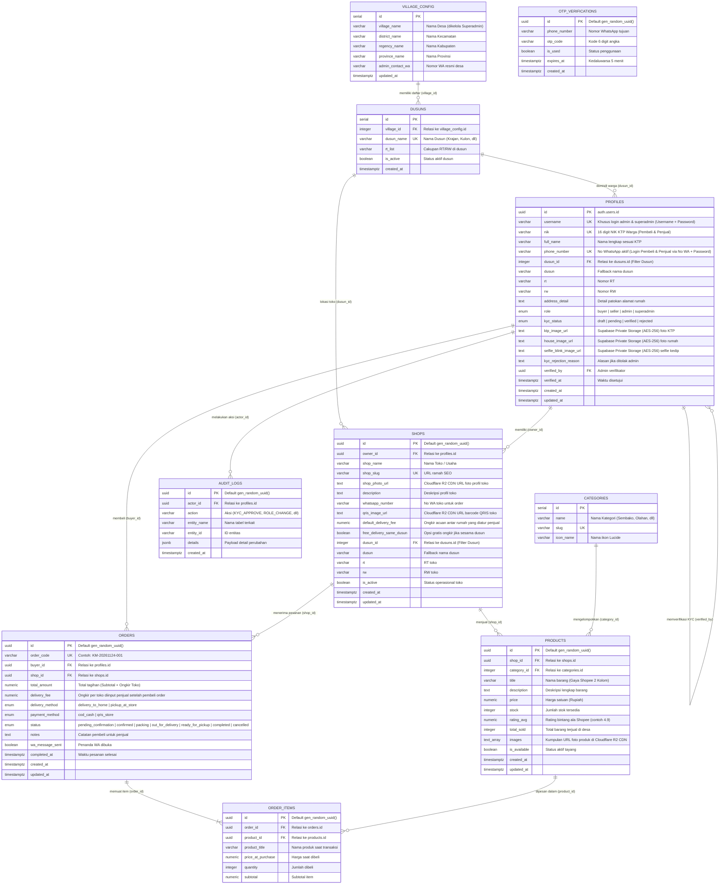

# Entity Relationship Diagram (ERD) — Kejagan Mart
**Proyek**: Kejagan Mart (Marketplace Khusus Se-Desa Kejagan)  
**Database**: Supabase PostgreSQL 16+  
**Tanggal**: 2026-11-24  

---

## 1. Visualisasi Diagram Relasi Entitas (Mermaid ERD)



---

## 2. Definisi Relasi & Integritas Data

1. **Relasi Kependudukan & Toko (`PROFILES` -> `SHOPS`)**:
   - Satu profil warga dapat memiliki 0 atau 1 Toko (pada fase MVP). Jika warga ingin berjualan, mereka mengaktifkan modul Toko.
   - `ON DELETE CASCADE`: Jika akun warga dihapus (misal hak hapus akun UU PDP), entitas toko terkait ikut terhapus bersih.
2. **Relasi Toko & Produk (`SHOPS` -> `PRODUCTS`)**:
   - Satu toko memiliki banyak produk (`1 to N`).
   - `ON DELETE CASCADE`: Menghapus toko menghapus seluruh produk yang dimilikinya.
3. **Relasi Pesanan (`ORDERS` & `ORDER_ITEMS`)**:
   - Satu pesanan dibuat oleh 1 Pembeli (`buyer_id`) ditujukan kepada 1 Toko (`shop_id`).
   - Pemisahan order per toko memastikan tidak ada kebingungan konfirmasi WhatsApp toko yang berbeda.
   - Kolom `price_at_purchase` dan `product_title` di `ORDER_ITEMS` diabadikan (snapshot) agar riwayat harga masa lalu tidak berubah meskipun penjual mengubah harga produk di kemudian hari.
4. **Keamanan Dokumen KYC (`PROFILES`)**:
   - Kolom `ktp_image_url`, `house_image_url`, dan `selfie_blink_image_url` menunjuk ke Supabase Storage Bucket bertipe **Private** (`kyc-documents`).
   - Bucket tersebut memiliki kebijakan akses ketat: hanya pemilik akun dan pengguna dengan role `admin` / `superadmin` yang dapat menghasilkan *Signed URL* berdurasi 10 menit untuk meninjau foto.

---

## 3. Indeks Performa Database (PostgreSQL Performance Indexes)

```sql
-- Indeks pencarian cepat produk berdasarkan toko dan status aktif
CREATE INDEX idx_products_shop_available ON products(shop_id, is_available);
CREATE INDEX idx_products_category ON products(category_id) WHERE is_available = TRUE;

-- Indeks pelacakan pesanan pembeli & toko
CREATE INDEX idx_orders_buyer_status ON orders(buyer_id, status);
CREATE INDEX idx_orders_shop_status ON orders(shop_id, status);
CREATE INDEX idx_orders_created_at ON orders(created_at DESC);

-- Indeks antrean verifikasi KYC untuk Admin & Login
CREATE INDEX idx_profiles_kyc_pending ON profiles(kyc_status) WHERE kyc_status = 'pending';
CREATE INDEX idx_profiles_username ON profiles(username) WHERE username IS NOT NULL;
CREATE INDEX idx_profiles_nik ON profiles(nik);
CREATE INDEX idx_profiles_phone ON profiles(phone_number);

-- Indeks masa berlaku OTP
CREATE INDEX idx_otp_phone_active ON otp_verifications(phone_number, is_used, expires_at);
```
