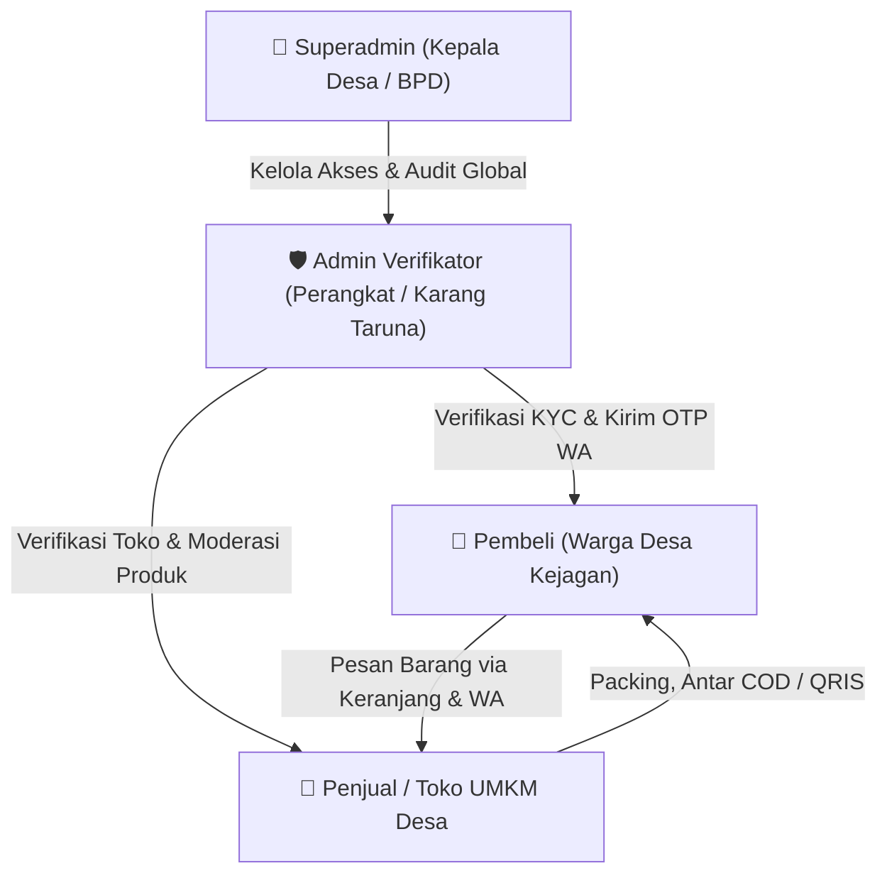
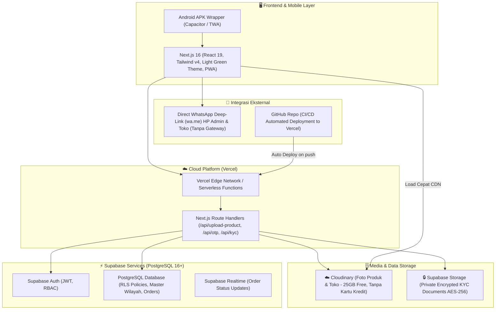
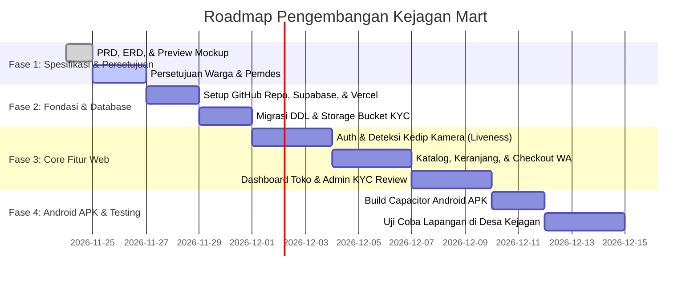

# Product Requirements Document (PRD) — Kejagan Mart
**Nama Proyek**: Kejagan Mart (Marketplace Khusus Warga Se-Desa Kejagan)  
**Versi**: 1.0.0 (Baseline Architecture)  
**Status**: In Review  
**Target Deployment**: GitHub + Vercel + Supabase + Android App (Capacitor/TWA)  
**Tanggal**: 2026-11-24  

---

## 1. Ringkasan Eksekutif (Executive Summary)
**Kejagan Mart** adalah platform marketplace digital hiperlokal yang dirancang khusus untuk ekosistem jual-beli warga se-desa (Desa Kejagan). Platform ini menjamin keamanan dan rasa saling percaya antar warga melalui verifikasi identitas ketat (KYC Warga: KTP, Foto Rumah/RT/RW, dan Selfie Deteksi Kedip Mata/Liveness Check) yang divalidasi oleh nomor WhatsApp Admin Desa.

Platform ini memfasilitasi transaksi harian warga dengan alur praktis: belanja kebutuhan lokal, konfirmasi pesanan terhubung langsung ke WhatsApp toko/penjual, opsi pengiriman COD (bayar di rumah) atau ambil mandiri di toko, serta pembayaran tunai maupun QRIS toko. Aplikasi berbasis web responsif (Next.js 16 + Supabase) yang dapat di-publish ke Vercel dan dibungkus menjadi file APK Android mandiri.

---

## 2. Latar Belakang & Masalah (Problem Statement)
- **Keterbatasan WhatsApp Story & Grup**: Jual-beli warga saat ini hanya mengandalkan status WhatsApp yang cepat tenggelam, tanpa katalog terstruktur, tanpa pencarian harga, dan tanpa riwayat order.
- **Risiko Penipuan & Orang Luar (Non-Warga)**: Transaksi lokal rentan disusupi penipu luar desa karena ketiadaan verifikasi domisili resmi.
- **Kesulitan Pendataan Ekonomi Desa**: Pemerintah Desa (Pemdes) tidak memiliki data riil mengenai potensi UMKM, komoditas lokal, dan volume perputaran uang di tingkat RT/RW.
- **Solusi Kejagan Mart**: Memberikan wadah resmi satu desa dengan gerbang KYC terverifikasi oleh Admin Desa, integrasi WhatsApp otomatis untuk transaksi tanpa ribet, serta sistem pencatatan transparan.

---

## 3. Sasaran & Metrik Keberhasilan (Goals & Success Metrics)

| Sasaran (Goal) | Metrik Utama | Target MVP (Bulan ke-1) |
|---|---|---|
| **Verifikasi Warga 100% Valid** | Rasio pengguna aktif terverifikasi KYC (KTP + Foto Rumah + Liveness) | 100% pengguna terdaftar lolos audit Admin |
| **Kecepatan Konfirmasi Order** | Waktu dari checkout keranjang hingga pesan terkirim ke WhatsApp toko | $< 2\text{ detik}$ |
| **Kinerja Loading Kilat (Core Web Vitals)** | Largest Contentful Paint (LCP) pada jaringan 3G/4G desa | $< 0.8\text{ detik}$ (Skor Lighthouse 98+) |
| **Efisiensi Kuota Internet Warga** | Konsumsi transfer data per kunjungan katalog desa | $< 250\text{ KB}$ (Hemat 85% dibanding e-commerce biasa) |
| **Kompresi Foto Otomatis di HP** | Rasio reduksi foto kamera HP warga (5-10MB) sebelum di-upload | Berkurang menjadi $\approx 70\text{ - }100\text{ KB}$ (Hemat data 95%) |
| **Keamanan Berlapis (Anti-Bobol)** | Insiden kebocoran data KTP / peretasan akun (OWASP Top 10) | 0 insiden (RLS Kedap Air + Token HttpOnly Cookie) |
| **Proteksi Brute-Force Login** | Batas maksimal percobaan salah password | Maks 5x coba / 15 menit ➔ Auto-Cooldown & CAPTCHA |
| **Latensi API Database (Supabase)** | Durasi query Supabase REST/PostgREST p95 | $< 80\text{ ms}$ via Edge Connection Pooling |
| **Ukuran Bundle Android APK** | Ukuran file APK instalasi di smartphone warga | $< 8\text{ MB}$ (Sangat ringan di HP spek minim) |

---

## 4. Peran Pengguna (User Roles & Personas)



### 4.1 Pembeli (Warga Desa)
- **Tujuan**: Membeli kebutuhan harian (sembako, sayur, makanan olahan, jasa) dari tetangga/toko terdekat di desa dengan harga bersahabat dan aman.
- **Karakteristik**: Mengutamakan kemudahan (tidak mau alur perbankan rumit), menyukai COD/bayar di tempat, terbiasa memakai WhatsApp.

### 4.2 Penjual / Toko (Pelaku Usaha Desa)
- **Tujuan**: Memasarkan produk ke seluruh warga desa tanpa potongan komisi pihak ketiga yang besar, menerima pesanan rapi via WhatsApp, mengelola stok sederhana.
- **Karakteristik**: Mengelola toko sendiri, butuh notifikasi pesanan instan via WhatsApp, menyediakan opsi diantar ke rumah atau ambil di toko.

### 4.3 Admin (Petugas Verifikator / Karang Taruna Desa)
- **Tujuan**: Memverifikasi pendaftaran warga (mencocokkan NIK KTP, foto rumah RT/RW, dan video/foto kedip liveness), mengelola pengiriman OTP WhatsApp, memoderasi produk yang dilarang.
- **Wewenang**: Menyetujui/menolak pendaftaran KYC dengan alasan tertulis, menonaktifkan produk bermasalah, menengahi perselisihan transaksi.

### 4.4 Superadmin (Kepala Desa / Pejabat Desa)
- **Tujuan**: Memantau kesehatan ekosistem ekonomi desa, mengelola akun admin, melihat rekap volume transaksi per RT/RW, dan mengendalikan kebijakan platform.
- **Wewenang**: Manajemen staf admin, konfigurasi master desa (data RT/RW Kejagan), audit log semua aktivitas, export laporan berkala.

### 4.5 Matriks Kredensial & Autentikasi Pengguna (Login Credentials)

Sesuai instruksi khusus sistem, terdapat pemisahan metode masuk (login) yang tegas antara warga (pembeli/penjual) dan pengelola (admin/superadmin):

| Peran (Role) | Kredensial Masuk (Login) | Tipe Akun | Hak Akses & Portal |
|---|---|---|---|
| **Pembeli (Warga)** | **Nomor WhatsApp + Password** | Publik Warga | Portal Utama Warga (Katalog, Keranjang, Pesanan) |
| **Penjual (Toko Warga)** | **Nomor WhatsApp + Password** | Publik Warga | Portal Utama + Akses Dashboard Toko Saya |
| **Admin (Verifikator Desa)** | **Username + Password** | Internal Desa | Portal Khusus Admin (`/admin/login` & Verifikasi KYC) |
| **Superadmin (Kepala Desa)** | **Username + Password** | Internal Desa | Portal Khusus Superadmin (`/admin/login` & Master Audit) |

---

## 5. Rincian Fitur (Feature Requirements)

### 5.1 Alur Autentikasi & Verifikasi Identitas (KYC Desa Kejagan)

#### A. Mekanisme Masuk (Login)
1. **Login Warga (Pembeli & Penjual)**:
   - Input: **Nomor WhatsApp** (contoh: `081234567890`) dan **Password**.
   - Sistem memverifikasi kredensial. Jika status KYC masih `PENDING_VERIFICATION`, akun dapat masuk namun dibatasi hanya dapat melihat status verifikasi hingga disetujui Admin.
2. **Login Petugas (Admin & Superadmin)**:
   - Input: **Username** (contoh: `admin_kejagan_01` atau `kades_kejagan`) dan **Password**.
   - Portal terisolasi pada rute `/admin/login` dengan perlindungan *rate-limiting* untuk mencegah percobaan *brute force*.

#### B. Registrasi Akun Warga (Pembeli & Penjual)
1. **Formulir Pendaftaran**:
   - Input Nama Lengkap (sesuai KTP), NIK (16 digit), Nomor WhatsApp aktif, Pilihan Dusun (dropdown dinamis dari master dusun), RT, RW Desa.
   - **Upload Dokumen**:
     - Foto e-KTP asli (disimpan di Supabase Private Bucket terenkripsi).
     - Foto Rumah Depan (menampilkan patokan lingkungan RT/RW).
     - **Foto Selfie Kedip Mata (Liveness Check)**: Deteksi interaktif via kamera browser/aplikasi yang memverifikasi kedipan mata pengguna (mencegah pemalsuan foto diam).
2. **Pengiriman OTP WhatsApp Langsung dari HP Admin (Tanpa Gateway Berlangganan)**:
   - Setelah formulir registrasi dikirimkan, sistem menghasilkan kode OTP 6 digit unik (berlaku 10 menit).
   - Data calon warga masuk ke antrean verifikasi Admin Desa.
   - Admin di HP-nya melihat pendaftar baru, lalu menekan tombol **"📱 Kirim OTP via WhatsApp Admin"**.
   - Tombol tersebut membuka aplikasi WhatsApp di HP Admin secara langsung via tautan resmi:
     `https://wa.me/628xxxxxxxxxx?text=*KEJAGAN%20MART%20-%20KODE%20OTP*%0AHalo%20Bpk/Ibu%20[Nama],%20kode%20OTP%20pendaftaran%20Anda:%20*[KODE_OTP]*`
   - Admin menekan tombol Kirim di WhatsApp pribadinya/nomor dinasnya.
   - Warga menerima pesan resmi langsung dari nomor HP Admin Desa yang mereka kenal, lalu menginput kode OTP 6 digit tersebut ke aplikasi.
   - **Keunggulan Sistem Tanpa Gateway**:
     - 100% Gratis selamanya (tidak ada biaya bulanan gateway API pihak ketiga).
     - Nomor pengirim adalah nomor asli Admin Desa yang dikenali warga.
     - Keamanan terjamin dengan sentuhan verifikasi langsung oleh aparatur desa.
3. **Persetujuan (Approval Gate) oleh Admin**:
   - Akun masuk status `PENDING_VERIFICATION`.
   - Admin memeriksa kecocokan data KTP, foto rumah, dan selfie kedip.
   - Jika valid: status berubah menjadi `VERIFIED`, akun dapat langsung bertransaksi.
   - Jika ditolak: status `REJECTED`, admin dapat mengklik tombol kirim alasan penolakan via WhatsApp dan warga dapat mengunggah ulang data yang diminta.

### 5.2 Fitur Pembeli (Buyer Experience)
- **Tampilan Katalog Produk Gaya Shopee (2-Column Grid Layout)**:
  - **Tata Letak Grid 2 Kolom**: Tampilan produk disajikan dalam format kartu 2 kolom (`grid-cols-2`) yang modern, bersih, dan familier seperti Shopee.
  - **Kartu Produk Kaya Informasi**:
    - Foto produk persegi (*aspect-square 1:1*) dengan sudut membulat halus (*rounded-2xl*).
    - Label badge di atas foto: **"COD Warga"**, **"⭐ 4.9"**, dan **"Lokal Kejagan"**.
    - Judul produk dibatasi 2 baris teks rapi (*line-clamp-2*).
    - Harga tercetak tebal dan menonjol dengan tipografi jelas (`Rp 68.000`).
    - Lencana Ongkir Transparan: **"🚚 Ongkir Rp 3.000"** atau **"🚚 Gratis Ongkir"** (sesuai tarif yang dimasukkan penjual).
    - Baris Sosial & Lokasi: Jumlah terjual (misal *"Terjual 60+"*) dan lokasi toko (*"📍 RT 02 Dusun Krajan"*).
    - Tombol cepat **"+ Beli"** langsung di kartu produk.
- **Katalog Terkurasi Desa dengan Filter Dusun & Kategori**:
  - **Filter Dusun Dinamis**: Pembeli dapat menyaring barang berdasarkan Dusun tertentu (misal Dusun Krajan, Dusun Kulon, Dusun Lor) yang diambil langsung dari master dusun desa.
  - **Filter Kategori Cepat**: Sembako, Makanan Siap Saji, Hasil Tani/Ternak, Jasa/Elektronik, Kerajinan RT.
  - **Pencarian Cepat**: Pencarian judul barang dan nama toko.
- **Keranjang Belanja Multi-Produk & Kalkulasi Ongkir Fleksibel**:
  - Pengelompokan keranjang per Toko/Penjual secara rapi.
  - **Pilihan Metode Pengiriman Pasca-Order**:
    - Opsi 1: **Diantar ke Rumah (COD)** ➔ Biaya ongkir dihitung **berdasarkan toko** (bukan akumulasi per item barang) dan ditetapkan langsung oleh penjual setelah pesanan masuk sesuai jarak RT/RW alamat pembeli. Di keranjang tertulis: *"Biaya Ongkir: Ditetapkan Toko Pasca-Order"*.
    - Opsi 2: **Ambil Mandiri di Toko** ➔ Biaya ongkir otomatis **Rp 0 (Gratis)**.
  - Ringkasan rincian tagihan transparan: Subtotal Barang + Biaya Ongkir Toko (ditetapkan pasca-order) = Total Tagihan Belanja.
- **Checkout Otomatis ke WhatsApp Penjual dengan Konfirmasi Ongkir Pasca-Order**:
  - Sistem meng-generate format teks pesanan rapi:
    ```text
    *PESANAN BARU KEJAGAN MART*
    ID Order: #KM-20261124-001
    Pembeli: Bpk. Slamet (RT 02 / RW 01, Dusun Krajan)
    Alamat: Jl. Melati No. 4, Dusun Krajan

    Rincian Barang:
    - 2x Beras Rojolele 5kg (Rp 136.000)
    - 1x Minyak Goreng 2L (Rp 32.000)
    Subtotal Produk: Rp 168.000
    Metode Pengiriman: Diantar ke Rumah (COD)
    Biaya Ongkir Toko: Menunggu penetapan oleh toko sesuai RT/RW
    ----------------------------------
    *Estimasi Tagihan: Rp 168.000 (+ Ongkir Toko)*
    Metode: Bayar di Tempat (COD Tunai / QRIS Toko)

    Mohon penjual memasukkan ongkir toko dan konfirmasi pesanan ini. Terima kasih!
    ```
  - Tombol langsung membuka aplikasi WhatsApp menuju nomor HP toko.
- **Riwayat Pesanan**:
  - Halaman memuat status: Menunggu Penetapan Ongkir Toko, Menunggu Konfirmasi, Sedang Disiapkan, Sedang Diantar / Siap Diambil, Selesai, Dibatalkan.

### 5.3 Fitur Penjual / Toko (Seller Center)
- **Pendaftaran Profil Toko**:
  - Input Nama Toko, Deskripsi Singkat, Foto Profil Toko / Banner, Pilihan Dusun (dropdown master dusun), RT/RW, dan Nomor WhatsApp Toko khusus order.
- **Fitur Ongkir Berdasarkan Toko Pasca-Order (Bukan per Item)**:
  - **Prinsip Utama**: Ongkir tidak dihitung per butir/item barang, melainkan satu biaya pengantaran per pesanan/transaksi toko tersebut.
  - **Alur Penetapan Ongkir Pasca-Order**:
    1. Pesanan masuk dari pembeli dengan status `pending_confirmation` (Menunggu Konfirmasi Ongkir).
    2. Penjual meninjau alamat pembeli (Dusun, RT, RW, dan patokan alamat rumah).
    3. Penjual menginput nominal ongkir untuk seluruh pesanan toko tersebut (contoh: Rp 2.000 untuk tetangga satu RT, Rp 5.000 untuk antar ke seberang dusun, atau Rp 0 jika digratiskan/diambil sendiri).
    4. Penjual menekan tombol **"✓ Tetapkan Ongkir & Konfirmasi Pesanan"**.
    5. Sistem otomatis memperbarui total tagihan (`Total = Subtotal Produk + Ongkir Toko`) dan penjual dapat mengirim rincian total final langsung ke WhatsApp pembeli.
- **Manajemen Produk (Shopee Style)**:
  - Tambah produk: Judul barang, kategori, harga (Rp), stok, foto produk (maks 3 foto), deskripsi lengkap. (Catatan: tarif ongkir tidak diatur per barang, melainkan per toko saat pesanan masuk).
  - Switch ketersediaan cepat: "Stok Tersedia" / "Habis".
- **Manajemen Pesanan Masuk**:
  - Notifikasi pesanan baru lengkap dengan alamat dan formulir penetapan ongkir toko.
  - Perubahan status pesanan bertahap:
    1. *Pesanan Masuk (Input Ongkir)* -> 2. *Terkonfirmasi & Sedang Dipacking* -> 3. *Siap Diambil / Sedang Diantar* -> 4. *Selesai (Pembeli Bayar COD / QRIS)*.
- **Upload QRIS Toko**:
  - Penjual dapat mengunggah gambar QRIS statis toko masing-masing untuk memudahkan pembeli membayar non-tunai saat barang diserahterimakan.

### 5.4 Fitur Admin (Verifikator Desa)
- **Antrean KYC & Pengiriman OTP Langsung via WhatsApp HP Admin**:
  - Tinjau pendaftaran baru dengan bukti sisi-ke-sisi: Foto KTP vs Foto Rumah vs Foto Selfie Kedip Mata.
  - Tombol aksi 1-klik: **"📱 Kirim Kode OTP via WhatsApp Admin"** yang langsung memicu aplikasi WhatsApp di smartphone Admin dengan nomor tujuan warga dan format teks kode OTP siap kirim.
  - Tombol persetujuan: **"Setujui Warga"** (mengaktifkan akun) atau **"Tolak & Kirim Alasan via WA"**.
- **Moderasi Konten & Produk Toko**:
  - Kemampuan menonaktifkan produk terlarang (miras, obat berbahaya, barang ilegal).
- **Pusat Resolusi Masalah (Dispute Handling)**:
  - Membantu menengahi jika ada pesanan fiktif atau kendala serah terima barang antar warga.

### 5.5 Fitur Superadmin (Kepala Desa / BPD / Administrator Utama)
- **Master Data Wilayah Desa Dinamis**:
  - Superadmin memiliki formulir khusus untuk mengatur dan mengedit identitas wilayah:
    1. **Nama Desa** (contoh: *Desa Kejagan*)
    2. **Nama Kecamatan** (contoh: *Kecamatan Tulangan*)
    3. **Nama Kabupaten** (contoh: *Kabupaten Sidoarjo*)
    4. **Nama Provinsi** (contoh: *Jawa Timur*)
- **Manajemen Master Dusun (CRUD Dusun Dinamis)**:
  - **Tambah Dusun Baru**: Input Nama Dusun (contoh: *Dusun Krajan*, *Dusun Kulon*, *Dusun Lor*) dan keterangan cakupan RT/RW.
  - **Edit & Hapus Dusun**: Mengubah penamaan dusun atau menonaktifkan dusun.
  - **Sinkronisasi Otomatis**: Daftar dusun yang ditambahkan Superadmin otomatis menjadi opsi filter belanja bagi pembeli, opsi alamat saat registrasi warga, dan domisili toko penjual.
- **Manajemen Hak Akses Admin (RBAC)**:
  - Membuatkan akun Admin baru (Username + Password) untuk staf desa/Karang Taruna serta menonaktifkan staf yang purna tugas.
- **Laporan & Analisis Ekonomi Desa**:
  - Grafik total transaksi per minggu/bulan, jumlah UMKM aktif, kategori komoditas paling laku.
  - Export laporan CSV/PDF untuk arsip BUMDes / Musrenbangdes.
- **Audit Trail & Keamanan Sistem**:
  - Log riwayat login, tindakan admin (siapa menyetujui siapa), dan aktivitas keamanan.

### 5.6 Legal & Privacy Trio (Mandatori Regulasi UU PDP No. 27/2022)
Sesuai kepatuhan hukum digital Indonesia dan Google Play / Apple Store:
1. **Kebijakan Privasi (`/privacy`)**:
   - Menjelaskan secara transparan bahwa data KTP, foto rumah, dan selfie liveness hanya digunakan semata-mata untuk verifikasi kependudukan warga Desa Kejagan.
   - Enkripsi data saat transmisi (TLS 1.3) dan saat penyimpanan (Supabase AES-256 Storage).
   - Jaminan tidak membagikan atau menjual data pribadi ke pihak ketiga komersial.
2. **Syarat & Ketentuan (`/terms`)**:
   - Ketentuan bahwa marketplace ini khusus transaksi legal di lingkungan desa.
   - Tanggung jawab kejujuran kualitas produk pada penjual dan kewajiban pembayaran saat barang sampai pada pembeli.
3. **Alur Hapus Akun & Data (`/delete-account` & `/api/user/data-deletion`)**:
   - Menyediakan form permohonan penghapusan akun mandiri untuk warga.
   - Backend endpoint otomatis yang menghapus identitas, foto KTP, dan biometrik selfie dari database sesuai hak privasi *Right to be Forgotten*.

### 5.7 Arsitektur Keamanan Berlapis (Anti-Bobol & Zero-Trust)
Untuk memastikan sistem tidak mudah dibobol dan data kependudukan warga Desa Kejagan terlindungi secara maksimal:
1. **Proteksi Brute-Force & Rate Limiting Ketat**:
   - Setiap endpoint login (`/api/auth/login-warga` dan `/api/auth/login-admin`) diproteksi oleh rate-limiter: maksimal 5 kali percobaan salah password per 15 menit per nomor WA / Username / IP.
   - Jika terlewati, akun/IP otomatis masuk masa tenggang (*cooldown*) 15 menit dan memerlukan verifikasi OTP tambahan.
2. **Token Sesi Kebal Malware & XSS (HttpOnly Cookie)**:
   - Token otentikasi (JWT) **tidak disimpan di `localStorage`**, melainkan dalam `HttpOnly, Secure, SameSite=Strict Cookie`.
   - Hal ini menjamin bahwa jika HP Android warga terpasang aplikasi malware/adware pihak ketiga, token login Kejagan Mart tidak dapat dicuri (*anti-session hijacking*).
3. **Row Level Security (RLS) PostgreSQL 100% Kedap Air**:
   - Seluruh tabel database dilindungi kebijakan RLS bawaan Supabase. Pembeli hanya dapat mengakses profil dan pesanannya sendiri. Penjual hanya dapat melihat pesanan tokonya.
   - Usaha memanipulasi parameter ID (`IDOR attack`) akan ditolak secara mutlak langsung di level kernel basis data.
4. **Enkripsi KTP & Liveness via Private Storage + Short-Lived Signed URL**:
   - Berkas KTP, foto rumah, dan foto selfie kedip mata disimpan di dalam *Private Bucket* Supabase berenkripsi AES-256.
   - Berkas tidak memiliki URL publik. Foto hanya dapat dilihat oleh Admin resmi melalui *Signed URL* kriptografis yang kedaluwarsa otomatis dalam **5 menit**.
5. **Sanitasi Masukan & Anti-SQL Injection**:
   - Seluruh payload data divalidasi menggunakan skema bertipe ketat (*Zod Validation*) dan query berparameter (*Parameterized SQL*), mengeliminasi risiko serangan SQL Injection dan Cross-Site Scripting (XSS).
6. **Blokir Anomali Geolocation**:
   - Sistem mendeteksi lokasi alamat IP login admin. Upaya login portal admin dari IP luar negeri (di luar Indonesia) otomatis diblokir oleh Vercel Firewall.

### 5.8 Mesin Performa Kilat & Hemat Kuota Internet Desa (Data-Saver Engine)
Dirancang khusus agar aplikasi dapat dibuka secepat kilat (LCP $< 0.8\text{ s}$), sangat ringan di ponsel spek hemat, dan tidak menghabiskan kuota internet warga:
1. **Integrasi Cloudinary Media Storage (100% Gratis 25GB/Bulan Tanpa Kartu Kredit)**:
   - Seluruh foto produk dagangan, foto profil toko, dan gambar QRIS disimpan di **Cloudinary**.
   - **Keunggulan Utama**: Cloudinary menyediakan paket gratis 25 GB/bulan tanpa memerlukan kartu kredit. Fitur optimasi bawaan (`f_auto, q_auto`) memastikan foto selalu dikirim dalam format WebP/AVIF teringan ke HP pembeli.
   - Terhubung langsung dengan CDN global berlatensi rendah di Indonesia, memastikan foto produk termuat dalam waktu $< 50\text{ ms}$.
2. **Kompresi Foto Otomatis Sisi Klien (Client-Side Canvas Downscaling)**:
   - Foto kamera HP warga yang berukuran asli 5MB hingga 10MB **tidak langsung di-upload**.
   - Sistem secara otomatis memperkecil dimensi gambar (maks 800x800px persegi ala Shopee) dan mengonversinya ke format WebP berkualitas 80% langsung di memori HP warga menggunakan HTML5 Canvas.
   - Ukuran file menyusut 98% dari $\approx 5.000\text{ KB}$ menjadi hanya $\approx 50\text{ - }70\text{ KB}$! Proses upload ke Cloudinary menjadi instan bahkan pada jaringan 3G/4G desa yang tidak stabil.
3. **Next.js 16 Server Components (Zero-JS Bloat & Light Green Theme)**:
   - Menggunakan arsitektur React Server Components (RSC) dengan tema terang bernuansa hijau desa. Komponen tampilan katalog diproses di server Vercel sehingga browser HP warga hanya menerima HTML & CSS ringan tanpa harus menjalankan bundle JavaScript berat.
   - Ponsel dengan RAM 2GB-3GB tetap berjalan mulus tanpa patah-patah (*lag*).
4. **PWA Offline-First & Service Worker Caching**:
   - Seluruh aset antarmuka (ikon, tema, kerangka desain) disimpan di cache lokal ponsel warga via Service Worker (*stale-while-revalidate*).
   - Membuka aplikasi berulang kali tidak menyedot kuota internet sama sekali untuk aset-aset inti.
5. **Kompresi Jaringan Modern (Brotli & Gzip)**:
   - Seluruh transfer data JSON API dikompresi menggunakan algoritma Brotli dengan rasio kompresi hingga 80%, menghemat transfer data seluler.
6. **Gambar Produk Bertingkat (Thumbnail Optimization)**:
   - Grid katalog produk hanya memuat gambar thumbnail berukuran mini ($250 \times 250\text{ px}$, ukuran berkas hanya $\approx 10\text{ - }15\text{ KB}$). Gambar resolusi penuh hanya dimuat jika pembeli mengklik detail produk.

---

## 6. Arsitektur Teknis (Technical Architecture)



### 6.1 Pilihan Teknologi & Rationale

| Komponen | Teknologi | Alasan Pemilihan |
|---|---|---|
| **Frontend Web** | Next.js 16+ App Router (React 19.2+) | SSR cepat, SEO optimal, performa tinggi dengan Turbopack, didukung penuh oleh Vercel. Tema terang hijau desa. |
| **Styling & UI** | Tailwind CSS v4 + Lucide Icons | Desain bersih, modern (gaya Shopee / Linear), responsif di layar ponsel hemat memori. |
| **Backend & Database** | Supabase (PostgreSQL 16+) | Database relasional tangguh, native Row Level Security (RLS), Auth bawaan, dan audit log desa. |
| **Penyimpanan Foto Barang (Media)** | **Cloudinary Media Storage** | **100% Gratis 25 GB/bulan Tanpa Kartu Kredit**, kompresi otomatis WebP/AVIF on-the-fly, CDN global super cepat di Indonesia. |
| **Penyimpanan Dokumen KYC Warga** | Supabase Private Storage (AES-256) | Foto KTP dan selfie warga diisolasi ketat dengan Signed URLs sementara 5 menit demi privasi hukum UU PDP. |
| **Integrasi WhatsApp** | Direct WhatsApp Deep-Link (`wa.me`) via HP Admin & Toko | **Tanpa Gateway Berbayar**. 100% Gratis selamanya, langsung memicu aplikasi WhatsApp di HP Admin (untuk kirim OTP) dan HP Pembeli/Penjual (untuk konfirmasi pesanan). |
| **Android APK** | Capacitor v7 / Trusted Web Activity (TWA) | Mengonversi Next.js menjadi APK Android ringan ($< 15\text{ MB}$) tanpa perlu menulis ulang dua codebase terpisah. |
| **Hosting & CI/CD** | Vercel + GitHub | Deployment otomatis setiap kali ada update di GitHub, gratis untuk tahap awal, latensi rendah di Indonesia. |

---

## 7. Skema Basis Data PostgreSQL (DDL)

```sql
-- ENUM TYPES
CREATE TYPE user_role AS ENUM ('buyer', 'seller', 'admin', 'superadmin');
CREATE TYPE kyc_status AS ENUM ('draft', 'pending', 'verified', 'rejected');
CREATE TYPE order_status AS ENUM ('pending_confirmation', 'confirmed', 'packing', 'out_for_delivery', 'ready_for_pickup', 'completed', 'cancelled');
CREATE TYPE delivery_method AS ENUM ('delivery_to_home', 'pickup_at_store');
CREATE TYPE payment_method AS ENUM ('cod_cash', 'qris_store');

-- 0. VILLAGE CONFIGURATION (Dikelola Penuh oleh Superadmin)
CREATE TABLE village_config (
    id SERIAL PRIMARY KEY,
    village_name VARCHAR(100) NOT NULL DEFAULT 'Kejagan',
    district_name VARCHAR(100) NOT NULL DEFAULT 'Tulangan', -- Kecamatan
    regency_name VARCHAR(100) NOT NULL DEFAULT 'Sidoarjo', -- Kabupaten
    province_name VARCHAR(100) NOT NULL DEFAULT 'Jawa Timur',
    admin_contact_wa VARCHAR(20),
    updated_at TIMESTAMPTZ DEFAULT NOW()
);

-- 0.1 MASTER DUSUN (Daftar Dusun Dinamis yang Ditambahkan Superadmin)
CREATE TABLE dusuns (
    id SERIAL PRIMARY KEY,
    village_id INT REFERENCES village_config(id) ON DELETE CASCADE,
    dusun_name VARCHAR(100) NOT NULL UNIQUE,
    rt_list VARCHAR(100), -- Cakupan RT/RW
    is_active BOOLEAN DEFAULT TRUE,
    created_at TIMESTAMPTZ DEFAULT NOW()
);

-- 1. PROFILES TABLE (Warga Desa & Petugas Admin)
CREATE TABLE profiles (
    id UUID PRIMARY KEY REFERENCES auth.users(id) ON DELETE CASCADE,
    username VARCHAR(50) UNIQUE, -- Khusus login Admin & Superadmin (Username + Password)
    nik VARCHAR(16) UNIQUE, -- Wajib untuk Pembeli & Penjual Warga
    full_name VARCHAR(100) NOT NULL,
    phone_number VARCHAR(20) UNIQUE, -- Wajib untuk Pembeli & Penjual (Login via No WA + Password)
    dusun_id INT REFERENCES dusuns(id) ON DELETE SET NULL, -- Relasi Master Dusun
    dusun_name VARCHAR(50), -- Fallback nama dusun
    rt VARCHAR(5),
    rw VARCHAR(5),
    address_detail TEXT,
    role user_role DEFAULT 'buyer' NOT NULL,
    kyc_status kyc_status DEFAULT 'draft' NOT NULL,
    ktp_image_url TEXT,
    house_image_url TEXT,
    selfie_blink_image_url TEXT,
    kyc_rejection_reason TEXT,
    verified_by UUID REFERENCES profiles(id),
    verified_at TIMESTAMPTZ,
    created_at TIMESTAMPTZ DEFAULT NOW(),
    updated_at TIMESTAMPTZ DEFAULT NOW(),
    -- Constraint: Pembeli & Penjual wajib memiliki phone_number dan NIK, Admin wajib memiliki username
    CONSTRAINT check_credentials_per_role CHECK (
        (role IN ('buyer', 'seller') AND phone_number IS NOT NULL AND nik IS NOT NULL) OR
        (role IN ('admin', 'superadmin') AND username IS NOT NULL)
    )
);

-- 2. SHOPS TABLE (Toko/Penjual)
CREATE TABLE shops (
    id UUID PRIMARY KEY DEFAULT gen_random_uuid(),
    owner_id UUID NOT NULL REFERENCES profiles(id) ON DELETE CASCADE,
    shop_name VARCHAR(100) NOT NULL,
    shop_slug VARCHAR(120) UNIQUE NOT NULL,
    shop_photo_url TEXT,
    description TEXT,
    whatsapp_number VARCHAR(20) NOT NULL,
    qris_image_url TEXT,
    dusun_id INT REFERENCES dusuns(id) ON DELETE SET NULL, -- Relasi Master Dusun
    dusun_name VARCHAR(50),
    rt VARCHAR(5) NOT NULL,
    rw VARCHAR(5) NOT NULL,
    default_delivery_fee DECIMAL(10, 2) DEFAULT 3000.00 CHECK (default_delivery_fee >= 0), -- Tarif ongkir antar rumah yang diatur penjual
    free_delivery_same_dusun BOOLEAN DEFAULT TRUE, -- Opsi gratis ongkir jika pembeli di dusun yang sama
    is_active BOOLEAN DEFAULT TRUE,
    created_at TIMESTAMPTZ DEFAULT NOW(),
    updated_at TIMESTAMPTZ DEFAULT NOW()
);

-- 3. PRODUCT CATEGORIES
CREATE TABLE categories (
    id SERIAL PRIMARY KEY,
    name VARCHAR(50) NOT NULL,
    slug VARCHAR(60) UNIQUE NOT NULL,
    icon_name VARCHAR(50) DEFAULT 'package'
);

-- 4. PRODUCTS TABLE (Shopee-Style Village Products)
CREATE TABLE products (
    id UUID PRIMARY KEY DEFAULT gen_random_uuid(),
    shop_id UUID NOT NULL REFERENCES shops(id) ON DELETE CASCADE,
    category_id INT REFERENCES categories(id) ON DELETE SET NULL,
    title VARCHAR(150) NOT NULL,
    description TEXT,
    price DECIMAL(12, 2) NOT NULL CHECK (price >= 0),
    stock INT DEFAULT 1 CHECK (stock >= 0),
    -- Catatan: Ongkir tidak per item barang, melainkan per transaksi toko yang diinput pasca-order
    rating_avg DECIMAL(3, 2) DEFAULT 5.00, -- Rating bintang ala Shopee (contoh: 4.9)
    total_sold INT DEFAULT 0, -- Jumlah terjual lokal desa
    images TEXT[] DEFAULT '{}',
    is_available BOOLEAN DEFAULT TRUE,
    created_at TIMESTAMPTZ DEFAULT NOW(),
    updated_at TIMESTAMPTZ DEFAULT NOW()
);

-- 5. ORDERS TABLE
CREATE TABLE orders (
    id UUID PRIMARY KEY DEFAULT gen_random_uuid(),
    order_code VARCHAR(30) UNIQUE NOT NULL,
    buyer_id UUID NOT NULL REFERENCES profiles(id),
    shop_id UUID NOT NULL REFERENCES shops(id),
    total_amount DECIMAL(12, 2) NOT NULL, -- Total tagihan (Subtotal Barang + Ongkir Toko)
    delivery_fee DECIMAL(12, 2) DEFAULT 0.00, -- Ongkir per transaksi toko (diinput penjual pasca-order)
    delivery_method delivery_method NOT NULL,
    payment_method payment_method NOT NULL,
    status order_status DEFAULT 'pending_confirmation' NOT NULL,
    notes TEXT,
    wa_message_sent BOOLEAN DEFAULT FALSE,
    completed_at TIMESTAMPTZ,
    created_at TIMESTAMPTZ DEFAULT NOW(),
    updated_at TIMESTAMPTZ DEFAULT NOW()
);

-- 6. ORDER ITEMS
CREATE TABLE order_items (
    id UUID PRIMARY KEY DEFAULT gen_random_uuid(),
    order_id UUID NOT NULL REFERENCES orders(id) ON DELETE CASCADE,
    product_id UUID REFERENCES products(id) ON DELETE SET NULL,
    product_title VARCHAR(150) NOT NULL,
    price_at_purchase DECIMAL(12, 2) NOT NULL,
    quantity INT NOT NULL CHECK (quantity > 0),
    subtotal DECIMAL(12, 2) NOT NULL
);

-- 7. OTP VERIFICATIONS
CREATE TABLE otp_verifications (
    id UUID PRIMARY KEY DEFAULT gen_random_uuid(),
    phone_number VARCHAR(20) NOT NULL,
    otp_code VARCHAR(6) NOT NULL,
    is_used BOOLEAN DEFAULT FALSE,
    expires_at TIMESTAMPTZ NOT NULL,
    created_at TIMESTAMPTZ DEFAULT NOW()
);

-- 8. AUDIT LOGS (Admin & Superadmin monitoring)
CREATE TABLE audit_logs (
    id UUID PRIMARY KEY DEFAULT gen_random_uuid(),
    actor_id UUID REFERENCES profiles(id),
    action VARCHAR(100) NOT NULL,
    entity_name VARCHAR(50) NOT NULL,
    entity_id VARCHAR(100),
    details JSONB,
    created_at TIMESTAMPTZ DEFAULT NOW()
);

-- ROW LEVEL SECURITY (RLS) POLICIES
ALTER TABLE profiles ENABLE ROW LEVEL SECURITY;
ALTER TABLE shops ENABLE ROW LEVEL SECURITY;
ALTER TABLE products ENABLE ROW LEVEL SECURITY;
ALTER TABLE orders ENABLE ROW LEVEL SECURITY;
ALTER TABLE order_items ENABLE ROW LEVEL SECURITY;
ALTER TABLE audit_logs ENABLE ROW LEVEL SECURITY;

-- Profiles: Warga hanya bisa baca profil sendiri, Admin/Superadmin bisa baca semua untuk verifikasi
CREATE POLICY "Users read own profile" ON profiles FOR SELECT USING (auth.uid() = id);
CREATE POLICY "Admins read all profiles" ON profiles FOR SELECT USING (
    EXISTS (SELECT 1 FROM profiles WHERE id = auth.uid() AND role IN ('admin', 'superadmin'))
);
CREATE POLICY "Admins update KYC status" ON profiles FOR UPDATE USING (
    EXISTS (SELECT 1 FROM profiles WHERE id = auth.uid() AND role IN ('admin', 'superadmin'))
);

-- Products: Publik desa bisa melihat produk aktif dari penjual terverifikasi
CREATE POLICY "Anyone can view active products" ON products FOR SELECT USING (is_available = TRUE);
CREATE POLICY "Sellers can manage own products" ON products FOR ALL USING (
    shop_id IN (SELECT id FROM shops WHERE owner_id = auth.uid())
);

-- Orders: Pembeli dan Pemilik Toko yang bersangkutan dapat melihat pesanan mereka
CREATE POLICY "Buyers can view own orders" ON orders FOR SELECT USING (buyer_id = auth.uid());
CREATE POLICY "Sellers can view received orders" ON orders FOR SELECT USING (
    shop_id IN (SELECT id FROM shops WHERE owner_id = auth.uid())
);
CREATE POLICY "Buyers can create orders" ON orders FOR INSERT WITH CHECK (buyer_id = auth.uid());
CREATE POLICY "Sellers can update order status" ON orders FOR UPDATE USING (
    shop_id IN (SELECT id FROM shops WHERE owner_id = auth.uid())
);
```

---

## 8. Kontrak API Utama (JSON Specification)

### 8.1 Login Warga: Pembeli & Penjual (`POST /api/auth/login-warga`)
- **Deskripsi**: Warga desa masuk menggunakan Nomor WhatsApp terdaftar dan Password.
- **Request Body**:
  ```json
  {
    "phone_number": "081234567890",
    "password": "PasswordRahasiaWarga123!"
  }
  ```
- **Response Success (200 OK)**:
  ```json
  {
    "success": true,
    "token": "eyJhbGciOiJIUzI1NiIsInR5cCI6IkpXVCJ9...",
    "user": {
      "id": "7a3e9c12-3b4d-4e5f-a6b7-8c9d0e1f2a3b",
      "full_name": "Siti Aminah",
      "phone_number": "081234567890",
      "role": "buyer",
      "kyc_status": "verified"
    }
  }
  ```

### 8.2 Login Petugas: Admin & Superadmin (`POST /api/auth/login-admin`)
- **Deskripsi**: Petugas verifikator dan Kepala Desa masuk menggunakan Username khusus dan Password.
- **Request Body**:
  ```json
  {
    "username": "admin_kejagan_01",
    "password": "PasswordAdminDesaSuperKuat!2026"
  }
  ```
- **Response Success (200 OK)**:
  ```json
  {
    "success": true,
    "token": "eyJhbGciOiJIUzI1NiIsInR5cCI6IkpXVCJ9...",
    "user": {
      "id": "1b2c3d4e-5f6a-7b8c-9d0e-1f2a3b4c5d6e",
      "username": "admin_kejagan_01",
      "full_name": "Budi Santoso (Karang Taruna)",
      "role": "admin"
    }
  }
  ```

### 8.3 Kirim OTP WhatsApp (`POST /api/auth/send-otp`)
- **Request Body**:
  ```json
  {
    "phone_number": "081234567890",
    "nik": "3515082103980001",
    "full_name": "Siti Aminah"
  }
  ```
- **Response Success (200 OK)**:
  ```json
  {
    "success": true,
    "message": "Kode OTP telah dikirim oleh WhatsApp Admin Desa Kejagan",
    "expires_in_seconds": 300
  }
  ```

### 8.2 Verifikasi KYC oleh Admin (`PATCH /api/admin/kyc-verify`)
- **Headers**: `Authorization: Bearer <admin_token>`
- **Request Body**:
  ```json
  {
    "target_user_id": "9b1deb4d-3b7d-4bad-9bdd-2b0d7b3dcb6d",
    "decision": "approved", // or "rejected"
    "rejection_reason": null
  }
  ```
- **Response Success (200 OK)**:
  ```json
  {
    "success": true,
    "user_id": "9b1deb4d-3b7d-4bad-9bdd-2b0d7b3dcb6d",
    "kyc_status": "verified",
    "verified_at": "2026-11-24T13:50:00Z"
  }
  ```

### 8.3 Buat Pesanan Baru (`POST /api/orders/create`)
- **Request Body**:
  ```json
  {
    "shop_id": "8f8b3c8e-4a61-455b-bfa1-d41c1d07c089",
    "delivery_method": "delivery_to_home",
    "payment_method": "cod_cash",
    "notes": "Tolong diantar sebelum jam 5 sore",
    "items": [
      {
        "product_id": "5e13589c-072a-4389-8d75-58a562149b2c",
        "quantity": 2
      }
    ]
  }
  ```
- **Response Success (201 Created)**:
  ```json
  {
    "success": true,
    "order_code": "KM-20261124-001",
    "total_amount": 162000,
    "wa_checkout_url": "https://wa.me/6281298765432?text=PESANAN%20BARU%20KEJAGAN%20MART..."
  }
  ```

---

## 9. Strategi Kemasan Aplikasi Android (Android APK Roadmap)
Untuk memenuhi instruksi "nnti bisa di panggil lewat aplikasi android":
1. **Pendekatan Rekomendasi: Capacitor v7 Native Wrapper**:
   - Next.js web application dibuild sebagai static/hybrid PWA.
   - Menggunakan `@capacitor/core` dan `@capacitor/android`.
   - Mengintegrasikan Capacitor Camera API untuk selfie liveness check dan izin kamera native di Android.
   - Menghasilkan file file `.apk` standalone yang siap dibagikan via WhatsApp grup desa atau di-upload ke Google Play Store.
2. **Kelebihan untuk Warga**:
   - Ukuran ringan ($< 15\text{ MB}$).
   - Membuka instan dari ikon layar utama HP Android warga.
   - Mampu menerima Push Notification saat pesanan diupdate atau OTP masuk.

---

## 10. Rencana Rilis & Milestone


